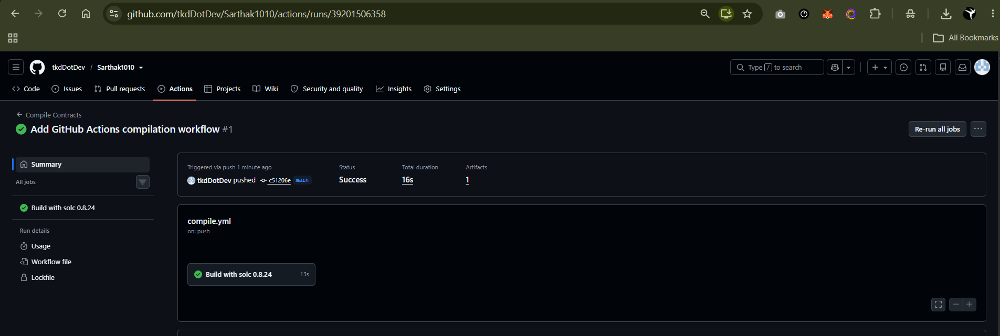
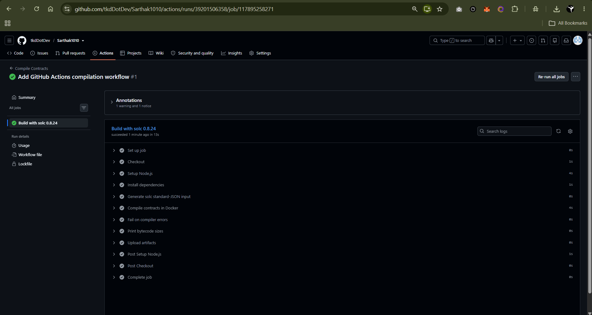

# SEPM Project – Part 1.2

# SEPM Project 1.1 and 1.2 
myremote/main

## GitHub Actions Solidity Compilation Pipeline

This repository contains the Solidity project and a GitHub Actions workflow that automatically runs the compilation pipeline when changes are pushed to `main` or when a pull request targets `main`.

### Workflow result

**Status: Successful**

The GitHub Actions run completed successfully. The job **Build with solc 0.8.24** passed in approximately 13 seconds.

### Pipeline steps verified

The successful run includes these steps:

- Set up job
- Check out repository
- Set up Node.js
- Install dependencies
- Generate Solidity Standard JSON input
- Compile contracts in Docker
- Check compiler errors
- Print bytecode sizes
- Upload artifacts
- Complete job

### Evidence screenshots

#### GitHub Actions run summary

#### Successful compilation job and pipeline steps

### Workflow run link

https://github.com/tkdDotDev/Sarthak1010/actions/runs/39201506358

### Repository

https://github.com/tkdDotDev/Sarthak1010
